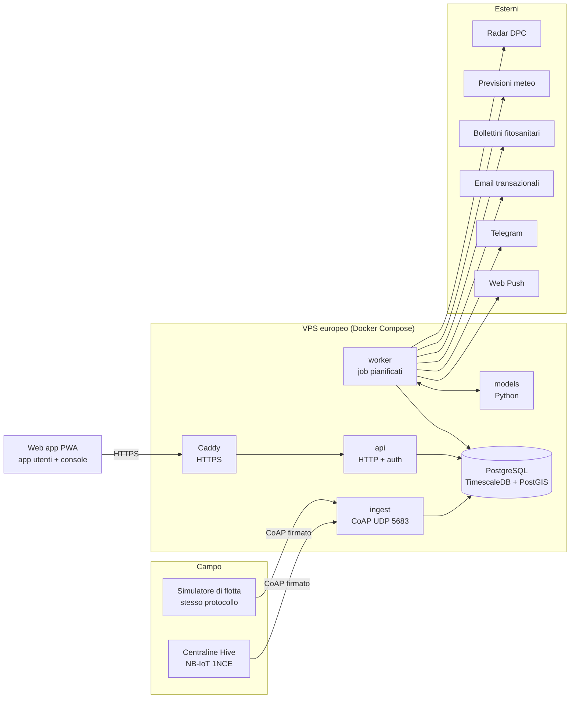
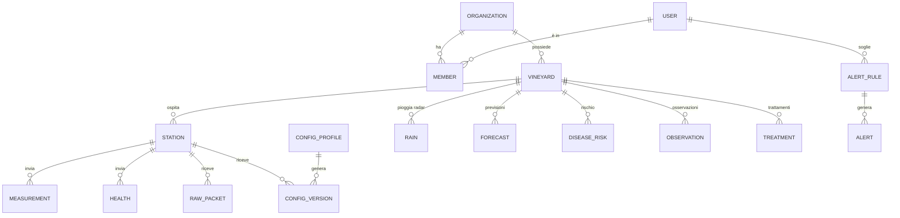
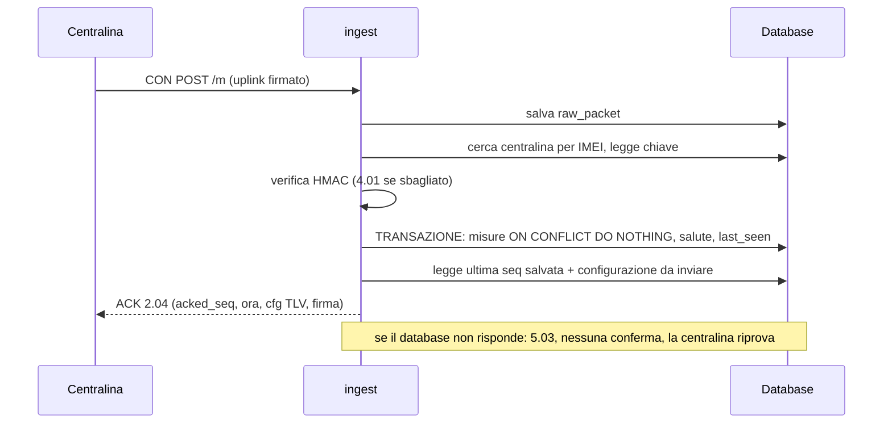

# Piattaforma Vinai 3.0 — come la costruiamo

Data: 2026-10-19 · Riferimenti: [piano di progetto](https://claude.ai/code/artifact/828d4781-d888-48a0-ba60-3518f99d7e18) (tracce B e C), [architettura](https://claude.ai/code/artifact/f68cf574-fe3f-4ea8-aa41-1021d73c7e07), [nota 0007](decisioni/0007-stack-piattaforma.md)

La piattaforma è **un solo sistema con tre porte**: la porta radio che riceve i pacchetti delle centraline, l'app per chi usa le centraline e la console da cui gestisci flotta, aziende e utenti.
Si costruisce **prima che la scheda sia pronta**: un simulatore di flotta parla con il server esattamente come parlerà il firmware vero, usando lo stesso formato e la stessa firma.
Così la data del primo traguardo (primo dato vero sul server a dicembre) dipende solo dal banco, non dal software.

---

## 1. Cosa deve fare

Requisiti ricavati dalla chat di reverse engineering, dal piano di progetto e dal firmware già scritto.

### Ricevere i dati

| Requisito | Da dove viene |
| --- | --- |
| CoAP confermabile su UDP 5683, POST `/m`, payload binario `packet.h` (max 460 byte, fino a 30 record da 14 byte) | nota 0002, `firmware/src/core/packet.h` |
| Firma HMAC-SHA256 troncata a 8 byte, chiave da 16 byte per centralina identificata dall'IMEI | `packet.h` |
| Salvataggio idempotente per (centralina, sequenza): i reinvii non creano righe doppie | nota 0003 |
| `acked_seq` nella risposta = ultima sequenza **davvero salvata nel database**. Se il database non risponde, niente ACK: la centralina tiene i dati in flash | nota 0003 |
| Ogni pacchetto salvato anche grezzo, prima di decodificarlo, per poterlo rielaborare | `CLAUDE.md` |
| Risposta con ora del server (s dal 2020-01-01 UTC), flag firmware, configurazione TLV versionata | `packet.h`, nota 0006 |
| Mai reinviare una versione di configurazione presente in `health.cfg_rejected` | nota 0004 |
| Valori "guasto" (`REC_*_FAULT`, `flags`) salvati come tali: il server non inventa mai dati | `record.h` |
| Salute di ogni pacchetto: batteria, RSRP, SNR, CSQ, reset, fallimenti modem, record persi | `health_t` |

### Gestire clienti e installazioni

- Ruoli: **Amministratore** (tu e App Salad), **Tecnico**, **Titolare**, **Agronomo** (anche su più aziende con un solo account), **Ospite**.
- Flusso: crei l'azienda → il titolare riceve l'invito via email → entra senza password (link o passkey) → invita agronomo e collaboratori → il tecnico inquadra il QR della centralina e la associa al vigneto con foto e GPS → al primo pacchetto la centralina diventa "attiva".
- Console: mappa della flotta, scheda centralina, configurazioni a profili con le versioni annullate in evidenza, laboratorio (chiavi, QR, registro di programmazione), allarmi tecnici, aziende e utenti, qualità dei dati, firmware e OTA (più avanti).
- Privacy: consensi al primo accesso, esportazione e cancellazione dell'account, registro degli accessi e delle azioni.

### Far vedere i dati ai clienti

- Rispondere in due secondi a **"devo trattare, e dove?"**.
- Schermate: Oggi, Mappa, Vigneto, Malattie, Osservazioni, Trattamenti, Notifiche, Azienda.
- PWA installabile, ultimi dati disponibili senza rete, osservazioni in campo anche offline.
- Notifiche push, email e Telegram con soglie scelte dall'utente.
- Export CSV ed Excel.
- Ogni allarme di malattia mostra il perché.

---

## 2. Architettura



Quattro processi, un database, una sola base di codice TypeScript per server e web:

| Processo | Compito | Perché separato |
| --- | --- | --- |
| `ingest` | riceve CoAP, verifica la firma, salva grezzo + misure + salute, risponde con ACK e configurazione | deve restare su anche se l'API ha un problema; è l'unico che parla con le centraline |
| `api` | HTTP JSON per web app e console, autenticazione, permessi | carico e rilasci indipendenti dalla porta radio |
| `worker` | job pianificati: radar, previsioni, centraline mute, allarmi, notifiche, rapporti | lavori lenti fuori dal percorso delle richieste |
| `models` (Python) | riceve dal worker i dati di un vigneto, calcola il rischio malattie e restituisce indice e spiegazione | Python per l'ecosistema scientifico; non scrive nel database: salva il worker |

Regola (da `CLAUDE.md`): solo il server (`ingest`, `api`, `worker`) scrive nel database. Centraline, servizi esterni e modelli passano sempre da lui.

---

## 3. Tecnologie

Criteri: un solo linguaggio per server e web (TypeScript), pochi servizi da tenere accesi, niente lock-in su cloud proprietari, costo intorno ai 10 € al mese. Dettagli e alternative scartate nella [nota 0007](decisioni/0007-stack-piattaforma.md).

| Area | Scelta | Ruolo |
| --- | --- | --- |
| Monorepo | pnpm workspaces + Turborepo | `server/`, `app/`, `packages/*` nello stesso repository, build e test incrementali |
| Runtime | Node.js 22 LTS | ingest, api, worker |
| CoAP | libreria `coap` per Node, verificata contro i vettori di test del firmware | porta radio |
| API | Hono + Zod | rotte tipizzate, validazione, client tipizzato per la web app |
| Database | PostgreSQL 17 + TimescaleDB + PostGIS | misure come hypertable, medie orarie e giornaliere già pronte, poligoni dei vigneti |
| Migrazioni e query | SQL scritto a mano + postgres.js | hypertable, compressione e aggregati sono SQL di TimescaleDB (nota 0008) |
| Autenticazione | Better Auth | link via email, passkey, aziende con ruoli e inviti, sessioni |
| Job | pg-boss (coda su PostgreSQL) | nessun Redis da gestire |
| Web app | React + Vite + TanStack Router + TanStack Query | una sola app con due aree: `/` utenti, `/console` amministrazione |
| UI | Tailwind CSS v4, componenti shadcn/ui (Radix) ridisegnati sui nostri token | accessibilità di base già risolta, aspetto tutto nostro |
| Movimento | Motion | transizioni morbide, numeri che si aggiornano senza scatti |
| Grafici | uPlot per le serie temporali, SVG su misura per indicatori e gauge | migliaia di punti fluidi anche su telefoni economici |
| Mappa | MapLibre GL con rilievo 3D, tile vettoriali open | vigneti e centraline sul terreno, rischio come "nebbia" colorata |
| PWA | vite-plugin-pwa (Workbox), cache delle query in IndexedDB, coda offline per le osservazioni | installabile, usabile senza rete |
| Notifiche | Web Push (VAPID), email transazionali con fornitore UE, bot Telegram | allarmi agli utenti e a te |
| Test | Vitest, Playwright (anche per i controlli visivi delle schermate) | ogni modifica verificata prima del merge |
| Deploy | Docker Compose sul VPS, Caddy per HTTPS, GitHub Actions | rilascio con un comando, rollback all'immagine precedente |
| Backup e monitoraggio | backup continui di PostgreSQL fuori sede, prova di ripristino trimestrale, Sentry per gli errori, controllo esterno di disponibilità | sapere subito se qualcosa non va |

### Strumenti di design e sviluppo per Claude Code

| Strumento | A cosa serve | Quando |
| --- | --- | --- |
| [Impeccable](https://github.com/pbakaus/impeccable) | skill di design per gli agenti: `init` scrive `PRODUCT.md`, `shape` progetta le schermate prima del codice, `craft` costruisce, `critique`, `audit` e `polish` correggono. Ha 61 regole automatiche contro l'aspetto "generato dall'AI" | da P0, installato nel repository (`npx impeccable install --providers=claude --scope=project`) |
| shadcn/ui CLI | aggiunge componenti accessibili come codice nostro, da ridisegnare | da P3 |
| Playwright | Claude apre l'app, fa screenshot a 375 px e a 1440 px, verifica i flussi; test end-to-end in CI | da P1 |
| Simulatore di flotta (nostro) | centraline finte con meteo realistico, guasti, reinvii e configurazioni rifiutate | da P1, resta per sempre come banco di prova |

---

## 4. Modello dei dati



| Tabella | Contenuto essenziale | Note |
| --- | --- | --- |
| `organization`, `member`, `user`, `invitation`, `passkey`, `session` | aziende, ruoli per azienda, utenti | gestite da Better Auth; il ruolo Amministratore/Tecnico è globale, gli altri sono per azienda |
| `vineyard` | nome, poligono (PostGIS), varietà, sesto d'impianto, anno, regione/provincia | la regione serve per i bollettini |
| `station` | IMEI, chiave cifrata, stato (`lab`, `pronta`, `installata`, `attiva`, `dismessa`), vigneto, posizione, foto, firmware, ultima ricezione | la chiave si cifra con una chiave master che sta solo nelle variabili d'ambiente |
| `measurement` (hypertable) | `station_id, time, seq, temp_c, hum_pct, press_hpa, wet_raw, wet_min, flags` in unità reali, `NULL` se il sensore è guasto | chiave primaria `(station_id, time, seq)`: l'idempotenza la garantisce il database (nota 0008) |
| `measurement_1h`, `measurement_1d` | aggregati continui: medie, minimi, massimi, minuti di bagnatura sommati | l'app legge quasi sempre da qui |
| `health` (hypertable) | campi di `health_t` per ogni pacchetto | grafici di batteria e segnale nella console |
| `raw_packet` | ora, IP sorgente, byte, esito (`ok`, `hmac`, `formato`, `sconosciuta`) | conservati 1 anno, poi compressi |
| `config_profile`, `config_version` | profili (per azienda o gruppi) e versioni per centralina: desiderata, inviata, applicata, rifiutata | la versione rifiutata è bloccata per sempre |
| `rain`, `forecast` | pioggia per vigneto ogni ora (radar DPC) e previsioni, con fonte e ora di lettura | una previsione si può sempre ricostruire |
| `disease_risk` | vigneto, malattia, ora, indice, livello, spiegazione (JSON), versione del modello | calcolata da `models`, salvata dal worker |
| `observation`, `treatment` | segnalazioni con foto e gravità, validazione dell'agronomo; trattamenti | le osservazioni validate sono i dati "veri" per calibrare i modelli |
| `alert_rule`, `alert`, `push_subscription` | soglie dell'utente, allarmi generati, dispositivi | |
| `audit_log` | chi ha fatto cosa e quando | console e privacy |

---

## 5. Il percorso di un pacchetto



Dettagli che contano:

- La configurazione si invia solo se `desired_version > cfg_ver` della centralina **e** non è mai stata rifiutata.
- Firma sbagliata o centralina sconosciuta ricevono subito `4.01`, database non disponibile `5.03`: niente silenzio, che farebbe ritrasmettere la centralina per 90 secondi a radio accesa (nota 0008).
- Il codec TypeScript del pacchetto si collauda con **vettori d'oro generati dal codice C del firmware**: un piccolo programma in `firmware/tests` scrive pacchetti di esempio in un file JSON, e il server deve leggerli e produrre risposte che il C accetta. Se cambia `packet.h` e non il server, il CI fallisce.

---

## 6. Design: moderno, futuristico, ma semplice

Direzione già concordata nel piano: **strumentazione di precisione per la vigna**.

- **Base scura** blu notte, numeri grandi con cifre a larghezza fissa; **modalità campo** chiara ad alto contrasto per il sole, con pulsanti grandi.
- **Colori con un significato**: verde foglia vuol dire "tutto bene", ambra "attenzione", viola acino "rischio". Il colore non è mai l'unica indicazione: c'è sempre anche un'etichetta o un'icona.
- **Effetti con misura**: vetro smerigliato solo sui pannelli in primo piano, luce leggera sulle curve, transizioni sotto i 250 ms, mappa 3D con il rischio come nebbia colorata.
- **Semplicità**:
  - la prima schermata dà una risposta, non un cruscotto di 20 grafici;
  - tutto il dettaglio è a un tocco;
  - sul telefono ci sono 4 voci in basso (Oggi, Mappa, Malattie, Altro), sul computer una barra laterale;
  - la console è pensata per il computer, l'app prima per il telefono.

Metodo, con Impeccable:

1. `/impeccable init`: scrive `PRODUCT.md` con utenti, contesto d'uso (vigna, sole, guanti, rete scarsa), tono e vincoli.
2. `/impeccable shape` su tre schermate chiave: **Oggi**, **Vigneto** e **Console › Flotta**.
3. **Due direzioni visive** per quelle tre schermate, come prototipi navigabili con dati simulati: per esempio "Cabina di pilotaggio", più tecnica e luminosa, e "Atlante", più cartografica e calma. Tu scegli e correggi.
4. Dalla direzione scelta nascono i token (colori OKLCH, tipografia, spaziature, movimento) in `DESIGN.md` e in un pacchetto `packages/ui`.
5. Ogni schermata nuova passa da `critique` e `audit` (accessibilità, prestazioni, telefono e computer) prima del merge.

Serve sapere presto se esiste già un marchio VinAI (logo, nome, colori): cambia il punto 3.

---

## 7. Fasi

Le date seguono i due traguardi del piano: **primo dato vero a metà dicembre 2026**, **pilota a marzo 2027**. Le fasi P1-P2 e P3 procedono in parallelo.

```mermaid
gantt
  dateFormat YYYY-MM-DD
  axisFormat %d %b
  section Fondamenta
  P0 Repo, strumenti, ambienti          :p0, 2026-10-26, 7d
  section Dati
  P1 Ingest, database, simulatore       :p1, after p0, 14d
  P2 Account, aziende, console base     :p2, after p1, 14d
  Primo dato vero dalla scheda al banco :milestone, m1, 2026-12-15, 0d
  section Design e app
  P3 Design: due direzioni, scelta      :p3, after p0, 21d
  P4 App PWA: Oggi, Vigneto, Mappa      :p4, after p3, 28d
  section Servizi
  P5 Dati esterni, allarmi, notifiche   :p5, 2027-01-11, 21d
  P6 Produzione, privacy, collaudo      :p6, 2027-02-01, 28d
  Pilota in campo                       :milestone, m2, 2027-03-15, 0d
```

| Fase | Cosa si costruisce | Si chiude quando |
| --- | --- | --- |
| **P0 Fondamenta** | monorepo pnpm + Turborepo; Docker Compose per lo sviluppo (PostgreSQL con Timescale e PostGIS); CI con lint, test e build; Impeccable installato e `PRODUCT.md` scritto; regole in `CLAUDE.md` per server e app | `pnpm dev` avvia tutto in locale e il CI è verde |
| **P1 Ingest + database + simulatore** | codec del pacchetto con i vettori d'oro del firmware; `ingest` CoAP; schema e aggregati Timescale; simulatore di flotta con meteo realistico e guasti | 50 centraline simulate per 7 giorni simulati: zero misure perse, zero doppioni, configurazione rifiutata mai reinviata |
| **P2 Account + console base** | Better Auth con link email, passkey, aziende, ruoli e inviti; console: flotta, scheda centralina, laboratorio (generazione chiave, QR, registro), associazione centralina-vigneto da telefono | crei un'azienda, inviti un titolare, associ una centralina simulata con il QR e vedi i dati arrivare |
| **P3 Design** | `shape` delle tre schermate chiave, due direzioni visive con dati simulati, scelta, token e componenti base | hai scelto una direzione e `DESIGN.md` è approvato |
| **P4 App PWA** | Oggi, Vigneto (grafici), Mappa 3D, Osservazioni offline, Azienda, installazione e guida per le notifiche su iPhone | un titolare installa l'app sul telefono e risponde a "devo trattare, e dove?" in 2 secondi, anche senza rete con gli ultimi dati |
| **P5 Dati esterni + allarmi** | pioggia dal radar DPC per vigneto; previsioni (servizio con licenza commerciale); motore delle soglie; push, email, Telegram; allarmi tecnici per te (centralina muta da 3 ore, batteria, sensore guasto); export CSV/Excel | un allarme di prova arriva sul telefono entro un minuto |
| **P6 Produzione + collaudo** | VPS di produzione, HTTPS, backup con prova di ripristino, monitoraggio; informativa e consensi; test end-to-end; prova di carico con 500 centraline simulate | ripristino da backup riuscito; 500 centraline simulate senza errori; checklist del pilota spuntata |
| *Dopo il pilota* | firmware e OTA dalla console; schermata Malattie piena con i modelli della traccia D; qualità dei dati; assistente AI | durante la stagione 2027 |

Il collegamento con i modelli delle malattie si prepara subito: la tabella `disease_risk` e la sua API esistono da P1. Così l'app mostra il rischio appena il servizio `models` comincia a calcolarlo, partendo dalla regola dei tre dieci per la peronospora.

---

## 8. Ambienti

| Ambiente | Dove | Riceve da |
| --- | --- | --- |
| Locale | computer di chi sviluppa, Docker Compose | simulatore |
| Prova | VPS, sottodominio `prova.` | simulatore 24 ore su 24 + la scheda al banco |
| Produzione | VPS (anche lo stesso, separato a livello di container e database, finché il carico lo permette) | centraline in campo |

---

## 9. Cosa serve per partire

- [ ] Dove sviluppiamo e dove gira la prova: questo server (ha già Docker) o un VPS Hetzner nuovo.
- [ ] Un dominio, con accesso al DNS per `app.`, `prova.` e il record della porta radio.
- [ ] Accesso in scrittura al repository GitHub per Claude Code, per caricare i rami e aprire le richieste di unione.
- [ ] Marchio VinAI, se esiste già: logo, colori, nome definitivo.
- [ ] Entro dicembre: fornitore di email transazionali (consigliati fornitori con server UE, come Brevo o Postmark) e bot Telegram.
- [ ] Entro gennaio: servizio di previsioni con licenza commerciale; accesso alle API di 1NCE per il consumo delle SIM.
